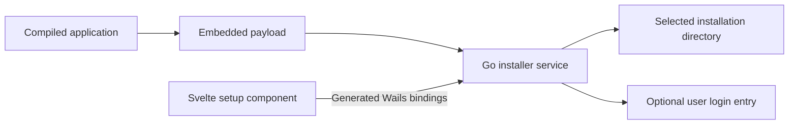

# Integration guide

## How the pieces fit

Build your target Wails application first. A separate installer executable embeds that binary and its resources. Adding the service to the target application itself is possible, but the target must then embed a distinct payload. Keep the installer and the application separate for normal distribution.



The Go engine does not import Wails. `Service` exposes methods that Wails can bind. The Svelte package accepts those generated functions through `createClient`, so no frontend binding path is built into the library. You can replace the component or the transport.

## Wails v2

### 1. Add the local packages

Install the Go module with `go get github.com/deedima3/wails-installer@main`. For local development, use the replacement commands in the [README](../README.md#add-it-to-your-project). The Svelte package is not published to npm yet, so install it from a local checkout or packed archive. Use a tagged Go version when release tags become available.

The root package is an importable Go library, with no Wails version dependency, CLI requirement, or frontend build requirement for consumers of its Go API:

```go
import installer "github.com/deedima3/wails-installer"
```

The [independent consumer module](../integration/consumer) tests this import using only the public API. The [Wails example](../examples/installer) is another separate Go module and binds the imported `Service` directly.

For a Windows checkout, Go accepts forward slashes in the replacement path. In PowerShell, quote paths that may contain spaces:

```powershell
go mod edit -require=github.com/deedima3/wails-installer@v0.0.0
go mod edit "-replace=github.com/deedima3/wails-installer=C:/src/wails-installer"
```

For a distributable frontend archive, run `npm pack --workspace @wails-installer/svelte --pack-destination <folder>` in this repository, then `npm install <folder>/wails-installer-svelte-0.2.0.tgz` in the consuming frontend. This installs the packaged component independently of the workspace layout.

### 2. Prepare the application

Run `wails build` in the target application. Copy the complete runtime payload into the installer project's `payload/` directory.

```text
your-installer/
  main.go
  go.mod
  wails.json
  payload/
    myapp                 # Windows: myapp.exe
    resources/            # If your application needs external files
  frontend/
    src/App.svelte
```

For macOS, copy the full `MyApp.app` directory and use `MyApp.app/Contents/MacOS/myapp` for `Executable`. The library marks that executable as runnable. Add other embedded helper programs to `Executables`, since `embed.FS` does not preserve executable bits. Ordinary files become `0644`, executable files `0755`, and payload directories `0755`, subject to the process umask. Empty payload directories are not copied; create required empty directories in `AfterCopy`.

Do not embed the installer binary in its own payload. Include only files the installed application needs. Build for each target OS and architecture separately.

### 3. Bind the installer service

This is a complete Wails v2 `main.go`. Replace the application identity and executable path. Build `frontend/dist` before a plain `go build`; `wails build` runs the configured frontend build for you.

```go
package main

import (
    "context"
    "embed"
    "io/fs"
    "log"
    "path/filepath"
    "runtime"

    installer "github.com/deedima3/wails-installer"
    "github.com/wailsapp/wails/v2"
    "github.com/wailsapp/wails/v2/pkg/options"
    "github.com/wailsapp/wails/v2/pkg/options/assetserver"
    wruntime "github.com/wailsapp/wails/v2/pkg/runtime"
)

//go:embed all:payload
var payload embed.FS

//go:embed all:frontend/dist
var assets embed.FS

func main() {
    source, err := fs.Sub(payload, "payload")
    if err != nil { log.Fatal(err) }
    executable := "myapp"
    if runtime.GOOS == "windows" { executable = "myapp.exe" }
    if runtime.GOOS == "darwin" {
        executable = "MyApp.app/Contents/MacOS/myapp"
    }
    engine, err := installer.New(installer.Config{
        ID: "com.example.myapp",
        Name: "My app",
        Version: "1.0.0",
        Description: "Your application's description.",
        Payload: source,
        Executable: executable,
        AllowStartup: true,
    })
    if err != nil { log.Fatal(err) }

    var appContext context.Context
    service := installer.NewService(engine, func() (string, error) {
        parent, err := wruntime.OpenDirectoryDialog(appContext,
            wruntime.OpenDialogOptions{Title: "Choose a parent folder"})
        if err != nil || parent == "" { return "", err }
        // The picker chooses an existing parent. Install needs a new child.
        return filepath.Join(parent, "MyApp"), nil
    })
    ui, err := fs.Sub(assets, "frontend/dist")
    if err != nil { log.Fatal(err) }
    err = wails.Run(&options.App{
        Title: "Install My app", Width: 1060, Height: 800,
        MinWidth: 560, MinHeight: 680,
        MaxWidth: 1060, MaxHeight: 800,
        AssetServer: &assetserver.Options{Assets: ui},
        OnStartup: func(ctx context.Context) { appContext = ctx },
        OnBeforeClose: func(context.Context) bool {
            status := service.State().Status
            if status == "installing" || status == "upgrading" || status == "uninstalling" {
                service.Cancel()
                return true // Wait for cleanup, then close again.
            }
            return false
        },
        OnShutdown: func(context.Context) { service.Cancel() },
        Bind: []interface{}{service},
    })
    if err != nil { log.Fatal(err) }
}
```

If your project already uses `OnStartup`, `OnShutdown`, or `OnBeforeClose`, compose these actions into the existing callbacks. Keep the `Service` pointer stable for the life of the window. Do not block Wails startup on installation.

The maximum dimensions cap the native window at the initial installer size while allowing a smaller window. Set `DisableResize: true` as well if you want a fixed size. For a borderless window with custom minimize and close buttons, follow [window size and borderless mode](customization.md#window-size-and-borderless-mode). These settings belong to the host Wails app; importing the installer service does not change your existing window.

### 4. Mount the Svelte component

Wails generates `wailsjs/go/installer/Service.js`. The relative import below assumes `App.svelte` is inside `frontend/src`. Confirm the path in your generated output, especially if you wrap or rename the bound service.

```svelte
<script lang="ts">
  import { Installer, createClient } from '@wails-installer/svelte';
  import * as bindings from '../wailsjs/go/installer/Service';

  const client = createClient(bindings);
</script>

<Installer {client} onInstalled={(result) => console.log(result.directory)} />
```

`Install`, `Upgrade`, and `Uninstall` return promises that settle after the operation and cleanup. The component polls `State` every 200 ms while active, and clears timers on unmount. It uses `Inspect` to detect a managed installation at the chosen path and offer maintenance actions. Unmounting does not cancel a running operation. Call `Cancel` explicitly or wire the window lifecycle as above. See [upgrade and uninstall](lifecycle.md).

The [example frontend](../examples/installer/frontend/src/backend.ts) uses a typed `window.go.installer.Service` lookup to allow a frontend build before binding generation. Generated imports are preferable when your project already generates bindings.

### 5. Build the installer

Set `frontend:build` to `npm run build` in `wails.json`. Build the component package before building the consumer if using a local checkout. Run `wails build` in the installer project. On Linux with WebKitGTK 4.1, add `-tags webkit2_41`.

The output contains both the installer UI and the embedded payload. Distribute that installer executable, or its `.app` bundle on macOS. Do not run `wails build -nsis` unless you intentionally want another installer around this one.

## Wails v3

Register the same Go service using the [Wails v3 service API](https://v3.wails.io/features/bindings/services/):

```go
service := installer.NewService(engine, yourDirectoryPicker)
app := application.New(application.Options{
    Name: "My app installer",
    Services: []application.Service{
        application.NewService(service),
    },
    // Keep your existing Assets and window configuration.
})
```

Use your v3 dialog API for `yourDirectoryPicker`, returning the full path to a new application directory. Passing `nil` keeps manual path entry available; clicking Browse then explains that no picker is configured. In the frontend, pass your generated v3 service functions to `createClient`. Binding file paths vary with the module name and generation options, so import the file Wails generates for your project.

Wire `Cancel` into your v3 shutdown/window-close handling. The core and binding contract are shared with v2, but the runnable desktop example and native build validation in this repository target v2. v3 integration is documented, not covered by a native example.

## Use another frontend

Bind `Service` and call `Info`, `State`, `Browse`, `Install`, `Cancel`, and `Launch` from React, Vue, vanilla JavaScript, or your own Svelte UI. The [API reference](api.md) describes the JSON contract. No CSS or Svelte dependency is needed by the Go library.

## Limitations and recovery

- Installation is per-user. `Install` requires a new directory. `Upgrade` and `Uninstall` accept only a matching ownership receipt; they refuse unowned or foreign folders. Keep application ID stable across versions. Close the application and run maintenance from a separate installer outside its install directory.
- Use trusted, static payloads and a trusted destination parent. The engine rejects payload traversal, symlinks, special files, Windows reserved filenames, and case collisions. It does not authenticate downloads or protect a directory controlled by another process. `embed.FS` is the recommended source.
- Hooks are trusted Go code. Write generated files only under `StageDirectory`. A hook must undo its own external changes and honor cancellation. Changes outside staging are not covered by cleanup.
- Windows startup registration uses `powershell.exe` and WScript.Shell COM. The generated shortcut is copied with exclusive creation, including on filesystems without hard-link support. Restricted PowerShell environments need a custom `StartupManager`.
- Linux startup depends on a desktop environment that supports XDG autostart. macOS writes a LaunchAgent for the next login, without loading it in the current session. OS settings may let the user disable login items.
- Application dependencies such as WebView2, WebKitGTK, native libraries, and signing/notarization are the application distributor's responsibility. macOS bundles with framework symlinks need a different payload strategy. The built-in copier does not preserve extended attributes, ACLs, symlinks, or timestamps.
- On macOS, the default launcher recognizes a main executable at `<bundle>.app/Contents/MacOS/<executable>` and opens its bundle through `/usr/bin/open`. Its LaunchAgent uses `/usr/bin/open -g` for the same bundle. Standalone binaries and executables on other platforms launch directly with their containing directory as the working directory. For custom arguments, implement `Launcher` as shown in [customization](customization.md). Resolve resources relative to the executable or bundle, rather than assuming a working directory.
- Concurrent instances targeting the same directory use a sibling `.<directory-name>.wails-installer-lock` directory. The native startup manager also uses a lock beside its login entry. A crash can leave locks, `.<id>-install-*` or `.<id>-uninstall-*` staging folders, and `.<directory-name>-backup-*` folders. Do not delete a backup until you have inspected it; it may be the only intact previous version. See [recovery](lifecycle.md#failure-and-crash-recovery).
- Rollback is best effort when permissions or filesystem errors prevent deletion. The returned error includes cleanup failures. Parent directories created by setup remain. Staging plus the final copy needs free disk space roughly equal to the payload, in addition to the installer executable.

## References

The integration uses Wails' [v2 application options](https://v2.wails.io/docs/reference/options/) and [v3 service registration](https://v3.wails.io/features/bindings/services/). Linux startup commands follow the [Desktop Entry Exec specification](https://specifications.freedesktop.org/desktop-entry/latest/exec-variables.html). The macOS registration format follows Apple's [LaunchAgent documentation](https://developer.apple.com/library/archive/documentation/MacOSX/Conceptual/BPSystemStartup/Chapters/CreatingLaunchdJobs.html), and bundle launching uses the `open` command described in Apple's [command-line primer](https://developer.apple.com/library/archive/documentation/OpenSource/Conceptual/ShellScripting/CommandLInePrimer/CommandLine.html).
